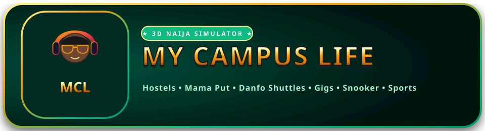

  

  <strong>The Ultimate Nigerian University Life-Simulator & Social Multiplayer World</strong>

  
  
  
  
  

---

## 🎓 About My Campus Life

**My Campus Life** is an authentic, vibrant Nigerian university life-sim browser game. Experience the full student journey from JAMB/Post-UTME admissions, faculty placement, 8:00 AM lectures in LT1, hostel cooking, Mama Put bukaterias, SUG politics, snooker mini-games, and side hustles (CampusPay) to graduation in the Great Convocation Hall!

### ✨ Key Features
- **⚡ Instant 0ms Load & Responsive UI**: Clean 2D HTML/SVG Student Studio with zero perceived load time, fast background asset streaming, and sharp native HTML Map, Emote, Task, and Chat modals.
- **🌐 Realtime Multiplayer ($0 Serverless Architecture)**:
  - Broadcast room presence via Supabase Realtime Channels & multi-tab BroadcastChannel.
  - See coursemates in real time with synchronized 3D outfits, melanin tones, and hairstyles.
  - Staff NPCs labeled clearly with `[NPC]` tags so real students stand out.
  - Shared UTC Campus Clock (`07:00 – 22:00` day/night cycle) across all players globally.
- **💳 CampusPay P2P Money Transfers**: Send and receive live in-game allowance transfers (`₦`) to coursemates in the room or via the in-game Smartphone Banking App.
- **🏛️ 16 Interactive Campus Locations**:
  1. Main Campus Courtyard & Quad
  2. Moremi Hall (Female) & Hall 2 (Male) Hostels
  3. Faculty Lecture Theatre 1 (LT1) & Science LT2
  4. Central University Library & Past Questions Archives
  5. Mama Put Bukateria & Canteen
  6. Madam Kikelomo Campus Mall & Fashion Boutique
  7. Silicon Lagoon Tech Hub & Campus Clinic
  8. Student Union Building (SUB) & 9-Ball Snooker Hall
  9. Sports Complex & Football Stadium
  10. University Fellowship Chapel
  11. Executive Barbing & Styling Salon
  12. Botanical Garden & Love Garden Gazebo
  13. Main Campus Security Gate & Danfo Shuttle Park
  14. University Senate & Registry Building
  15. Great Hall of Convocation & Alumni Arena
  16. Admissions Matriculation Booth
- **📱 In-Game Smartphone**: AMOLED wallpapers, Schedule Tracker, Campus Gigs & Hustles, Bank App, Live Player Lobby with 1-click room teleport, and WhatsApp-style Chat.

---

## 🎨 Official Brand Logos & App Icons

| Asset | Preview | Description |
| :--- | :--- | :--- |
| **Horizontal Banner** | [`docs/logo_horizontal.svg`](./docs/logo_horizontal.svg) | Full banner with emblem, title, and badges |
| **Square Vector Crest** | [`docs/logo.svg`](./docs/logo.svg) | 3D mortarboard, gold Naira sign, and laurel crest |
| **Minimal Icon** | [`docs/logo_minimal.svg`](./docs/logo_minimal.svg) | Clean squircle icon for favicons and web apps |
| **3D App Icon (v1)** | [`docs/app_icon_v1.jpg`](./docs/app_icon_v1.jpg) | High-detail 3D render with gold rim lighting |
| **3D App Icon (v2)** | [`docs/app_icon_v2.jpg`](./docs/app_icon_v2.jpg) | 3D render with embossed "MCL" varsity ribbon |
| **3D App Icon (v3)** | [`docs/app_icon_v3.jpg`](./docs/app_icon_v3.jpg) | High-contrast centered crest edition |

---

## 🛠️ Tech Stack & Architecture

- **Game Engine**: Godot 4.7.2 (GL Compatibility Renderer / WebGL 2)
- **Frontend Web Shell**: HTML5, Responsive CSS3, SVG Vector Mannequins, Canvas 2D Snooker Physics
- **Cloud Backend**: Supabase (PostgreSQL 15, Row-Level Security, GoTrue Auth, Realtime Phoenix Channels)
- **Deployment**: Vercel Serverless (`vercel.json` with build-time environment variable injection)

---

## 🚀 Live Website

Play live: **[mycampuslife.vercel.app](https://mycampuslife.vercel.app)** *(or via custom domain)*

